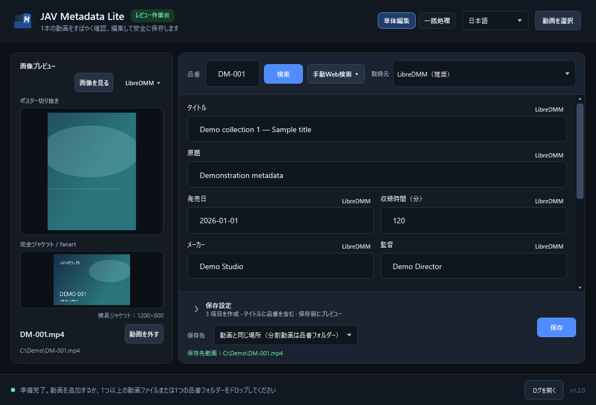

# JavMetaLite


[简体中文](README.zh-Hans.md) · [繁體中文](README.zh-Hant.md) · [English](README.md) · **日本語**

[](https://github.com/Noredge/JavMetaLite/actions/workflows/ci.yml)
[](https://github.com/Noredge/JavMetaLite/actions/workflows/macos.yml)

> Windows **1.2.3** · macOS **1.0.0（build51）**。

ローカル動画の情報を確認・整理する Windows／macOS アプリです。単体編集と一括処理に対応し、Jellyfin 用のメタデータや画像を出力できます。

## ダウンロード

| プラットフォーム | 動作環境 | ダウンロード |
| --- | --- | --- |
| Windows **1.2.3** | Windows 10/11 x64 | [ポータブル ZIP](https://github.com/Noredge/JavMetaLite/releases/download/v1.2.3/JavMetaLite-v1.2.3-win-x64-portable.zip) · [Release](https://github.com/Noredge/JavMetaLite/releases/tag/v1.2.3) |
| macOS **1.0.0** | Apple Silicon · macOS 15 以降 | [App ZIP](https://github.com/Noredge/JavMetaLite/releases/download/macos-v1.0.0/JavMetaLite-macOS-arm64-Release-adhoc.zip) · [Release](https://github.com/Noredge/JavMetaLite/releases/tag/macos-v1.0.0) |

起動前に Release の SHA-256 を確認してください。Windows の内蔵ブラウザーには WebView2 が必要です。macOS 版はアドホック署名のみで未公証です。[初回起動ガイド](macos/README.md#first-launch)を参照してください。Intel は未検証です。



[その他のスクリーンショット](docs/SCREENSHOTS-v1.2.0.md) · 画像とデータは合成デモです。

## 主な機能

- 動画の追加やフォルダーのスキャン、CD1/CD2 のグループ化、キューでの一括確認。
- LibreDMM（標準・推奨）、R18.dev、カスタムの複数取得元に対応。JAVLibrary は手動 Web 検索のみ。
- ローカル NFO の編集、画像の取得元とスチル画像の選択、NFO・ポスター・fanart・任意のスチル画像（`extrafanart`）の出力。
- 作品専用フォルダーの `movie.nfo` と画像に対応。単一動画を元のフォルダーに保存する場合は、その命名を維持します。
- ビューアーでの画像比較とローカル画像削除、メイン画面での低解像度ジャケットの注意表示。
- 保存前の変更プレビュー、動画の元の場所への保存または指定フォルダーへの整理。簡体字中国語・繁体字中国語・英語・日本語に対応。

## ソースからビルド

Git と [global.json](global.json) 指定の .NET SDK をインストールし、リポジトリをクローンしてルートで実行します。

**Windows（PowerShell）**

```powershell
dotnet build .\windows\JavMetaLite.App\JavMetaLite.App.csproj -c Release
.\scripts\New-ReleasePackage.ps1
.\scripts\Test-PortablePackage.ps1
```

**macOS（macOS 15 以降の SDK を含む Xcode または Command Line Tools）**

```sh
./scripts/macos/package.sh --arch arm64 --configuration Release --sign-mode adhoc
./scripts/macos/test.sh --arch arm64 --configuration Release
```

初回ビルド時に NuGet パッケージを復元します。出力先は Windows が `release/`、macOS が `artifacts/macos/` です。 [Windows](windows/README.md) · [macOS](macos/README.md)

## リポジトリ構成

| ディレクトリ | 用途 |
| --- | --- |
| [windows/](windows/README.md) | Windows アプリとテスト |
| [macos/](macos/README.md) | macOS ネイティブアプリ、Worker とテスト |
| [shared/](shared/README.md) | 共通 Core、ポータブル画像処理とテスト |
| [docs/](docs/README.md) | 利用ガイド、技術文書と過去の記録 |
| [scripts/](scripts/README.md) | ビルド、テスト、リリースツール |

[ドキュメント](docs/README.md) · [Changelog](CHANGELOG.md) · [MIT License](LICENSE) · [Third-party notices](THIRD_PARTY_NOTICES.md)
