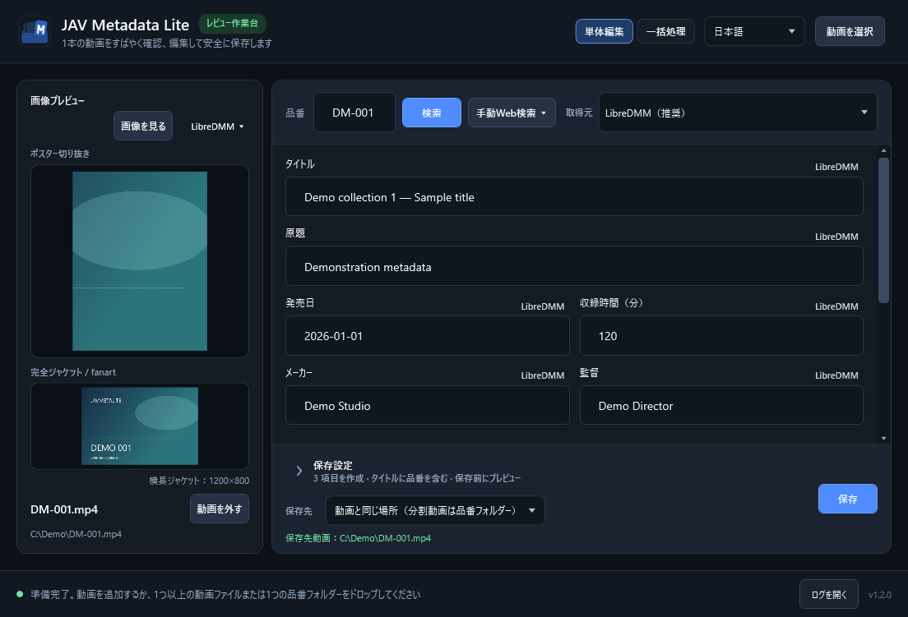

# JavMetaLite


[简体中文](README.zh-Hans.md) · [繁體中文](README.zh-Hant.md) · [English](README.md) · **日本語**

[](https://github.com/Noredge/JavMetaLite/actions/workflows/ci.yml)
[](https://github.com/Noredge/JavMetaLite/actions/workflows/macos.yml)

> Windows **1.2.3** · macOS **0.4.0 プレビュー2（build47）**。

ローカル動画の情報を確認・整理する Windows／macOS アプリです。単体編集と一括処理に対応し、Jellyfin 用のメタデータや画像を出力できます。



画像と情報は合成デモです。[その他の画面](docs/SCREENSHOTS-v1.2.0.md)。

## 主な機能

- 動画の追加やフォルダーのスキャン、CD1/CD2 のグループ化、キューでの一括確認。
- LibreDMM（標準・推奨）、R18.dev、カスタムの複数取得元に対応。JAVLibrary は手動 Web 検索のみ。
- ローカル NFO の編集、画像の取得元とスチル画像の選択、NFO・ポスター・fanart・任意のスチル画像（`extrafanart`）の出力。
- 作品専用フォルダーの `movie.nfo` と画像に対応。単一動画を元のフォルダーに保存する場合は、その命名を維持します。
- ビューアーでの画像比較とローカル画像削除、メイン画面での低解像度ジャケットの注意表示。
- 保存前の変更プレビュー、動画の元の場所への保存または指定フォルダーへの整理。簡体字中国語・繁体字中国語・英語・日本語に対応。

## クイックスタート（Windows）

Windows 10/11 x64 が必要です。.NET Runtime の別途インストールは不要ですが、内蔵ブラウザーには Microsoft Edge WebView2 Runtime が必要です。

1. [Releases](https://github.com/Noredge/JavMetaLite/releases) の公開済みポータブル ZIP、または案内されたローカル版を取得し、SHA-256 を確認して展開します。
2. `JavMetaLite.exe` を実行し、動画やフォルダーを選択またはドロップします。
3. 品番を確認して検索し、テキスト・画像・保存設定を必要に応じて調整します。
4. 保存ボタンを押して変更プレビューを確認します。一括保存で全動画のプレビューを開く必要はありません。

## 注意点

- 一括検索には LibreDMM を推奨します。R18 はレート制限で遅くなる場合があります。
- 終了後のキュー復元はありません。キューからの削除は動画ファイルを削除しませんが、確認済みのローカル画像削除は即時実行です。
- 重要な動画はバックアップしてください。保存は失敗またはキャンセルで停止します。復元失敗時は復元用フォルダーを保持してください。
- 取得元には成人向けコンテンツが含まれる場合があります。サイトの規約、適用される年齢条件・法令を守ってください。

## ソースからビルド（Windows）

Windows 10/11 x64 に Git と [global.json](global.json) で指定された .NET SDK（現在は 10.0.400）をインストールし、PowerShell で実行します。

```powershell
git clone https://github.com/Noredge/JavMetaLite.git
cd JavMetaLite
dotnet build .\JavMetaLite.App\JavMetaLite.App.csproj -c Release
dotnet run --project .\JavMetaLite.App\JavMetaLite.App.csproj -c Release --no-build
```

ビルド時に NuGet パッケージが自動復元されるため、初回はネットワーク接続が必要です。リポジトリのルートで自己完結型ポータブルパッケージを作成・検証します。

```powershell
.\scripts\New-ReleasePackage.ps1
.\scripts\Test-PortablePackage.ps1
```

EXE を含むフォルダー、ZIP、SHA-256 ファイルは `release/` に出力されます。全テストの実行方法は[開発とテスト](TESTING.md)を参照してください。

## macOS プレビュー版

**Apple Silicon · macOS 15 以降。** ネイティブエディターでポスターとジャケット全体を同時に表示し、情報・画像の編集、チェックした動画の一括検索・保存ができます。標準で保存前に変更を確認し、未編集の NFO 内容を保持してファイルの競合を確認します。設定は自動保存されます。

[macOS 0.4.0 Preview 2 (build47)](https://github.com/Noredge/JavMetaLite/releases/tag/macos-v0.4.0-preview.2) から [App ZIP](https://github.com/Noredge/JavMetaLite/releases/download/macos-v0.4.0-preview.2/JavMetaLite-macOS-arm64-Release-adhoc.zip) を取得し、展開して `JavMetaLite.app` を開きます。.NET のインストールは不要です。

ビルドには [global.json](global.json) 指定の SDK と、macOS 15 以降の SDK を含む Xcode または Command Line Tools が必要です。リポジトリのルートで実行します。

```sh
./scripts/macos/package.sh --arch arm64 --configuration Release --sign-mode adhoc
./scripts/macos/test.sh --arch arm64 --configuration Release
```

出力先は `artifacts/macos/` です。CI 版はアドホック署名のみで、公証していません。Intel は未検証です。[Mac ガイド](macos/README.md) · [検証状況](docs/macos/STATUS.md)。

## 詳細

[macOS リリースノート](https://github.com/Noredge/JavMetaLite/releases/tag/macos-v0.4.0-preview.2) · [Windows リリースノート](docs/RELEASE-NOTES-v1.2.3.md) · [Docs](docs/README.md) · [変更履歴](CHANGELOG.md) · [開発とテスト](TESTING.md)

Windows のログと設定は `%LOCALAPPDATA%\JavMetaLite` に保存されます。

[MIT License](LICENSE) · © 2026 Noredge · [サードパーティーについて](THIRD_PARTY_NOTICES.md)。取得元サイトとは提携しておらず、本プロジェクトのライセンスはサイトのデータには適用されません。
