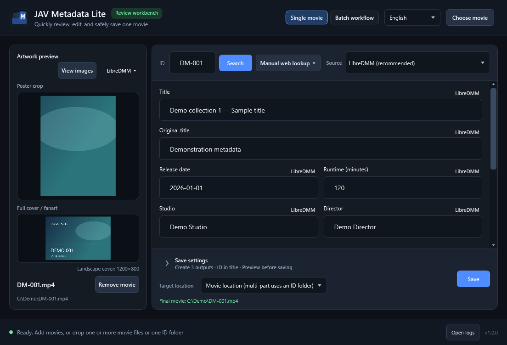

# JavMetaLite


[简体中文](README.zh-Hans.md) · [繁體中文](README.zh-Hant.md) · **English** · [日本語](README.ja.md)

[](https://github.com/Noredge/JavMetaLite/actions/workflows/ci.yml)
[](https://github.com/Noredge/JavMetaLite/actions/workflows/macos.yml)

> Windows **1.2.3** · macOS **0.4.0 Preview 2 (build47)**.

A Windows and macOS app for reviewing and organizing local movie metadata, individually or in batches, with Jellyfin-compatible output.



Synthetic demo data. [More screenshots](docs/SCREENSHOTS-v1.2.0.md).

## Features

- Add movies or scan folders; group CD1/CD2 parts and review movies in a batch queue.
- Search with LibreDMM (recommended default), R18.dev or custom multi-source rules. JAVLibrary is manual web lookup only.
- Edit local NFO metadata, choose artwork sources and stills, and export NFO, poster, fanart and optional stills (`extrafanart`).
- Read `movie.nfo` and folder-level artwork in dedicated movie folders; retain their names when saving in place.
- Compare and delete local images in the viewer; the main window flags low-resolution covers for review.
- Preview file changes before saving; keep movies in place or organize them into a chosen folder. Four UI languages supported.

## Quick start (Windows)

Windows 10/11 x64. No separate .NET Runtime installation; the embedded browser requires Microsoft Edge WebView2 Runtime.

1. Get a published portable ZIP from [Releases](https://github.com/Noredge/JavMetaLite/releases), or use the supplied local build. Verify its SHA-256 and extract it.
2. Run `JavMetaLite.exe`, then choose or drop movies/folders.
3. Check IDs, search and adjust metadata, images and save settings as needed.
4. Click Save and review the changes. Batch saving does not require opening every movie's preview.

## Keep in mind

- LibreDMM is recommended for batches. R18 rate limits can slow searches.
- The queue is not restored after closing. Removing queue entries does not delete movie files; confirmed local-image deletion is immediate.
- Back up important media. Saves stop on failure or cancellation; keep recovery folders if restoration fails.
- Sources may contain adult material. Respect their terms and applicable age/legal requirements.

## Build from source (Windows)

On Windows 10/11 x64, install Git and the exact .NET SDK pinned in [global.json](global.json) (currently 10.0.400). In PowerShell:

```powershell
git clone https://github.com/Noredge/JavMetaLite.git
cd JavMetaLite
dotnet build .\JavMetaLite.App\JavMetaLite.App.csproj -c Release
dotnet run --project .\JavMetaLite.App\JavMetaLite.App.csproj -c Release --no-build
```

The build restores NuGet packages automatically; the first build needs network access. To create and verify a self-contained portable package from the repository root:

```powershell
.\scripts\New-ReleasePackage.ps1
.\scripts\Test-PortablePackage.ps1
```

The EXE folder, ZIP and SHA-256 files are written to `release/`. See [Development and testing](TESTING.md) for the full test suite.

## macOS preview

**Apple Silicon · macOS 15+.** The native editor shows the poster and full cover together, with metadata/artwork editing and checkbox-based batch queries and saves. Save preview is on by default; unedited NFO content is preserved and file conflicts are checked before writing. Common settings are remembered.

Download the [App ZIP](https://github.com/Noredge/JavMetaLite/releases/download/macos-v0.4.0-preview.2/JavMetaLite-macOS-arm64-Release-adhoc.zip) from [macOS 0.4.0 Preview 2 (build47)](https://github.com/Noredge/JavMetaLite/releases/tag/macos-v0.4.0-preview.2), extract it and open `JavMetaLite.app`. The runtime is bundled.

The GitHub package uses ad-hoc signing, without Developer ID or notarization. This project permits that signing mode for stable releases too; it does not mean Apple has verified the publisher or scanned the app. Verify the ZIP against the release's SHA-256, extract it and move `JavMetaLite.app` to Applications. If macOS blocks the trusted app because its developer cannot be verified or Apple cannot check it, try opening it first, then use **System Settings → Privacy & Security → Open Anyway** and confirm Open for this app. Do not bypass a damaged-app or malware alert. [Apple's instructions](https://support.apple.com/en-us/102445) · [First launch](macos/README.md#first-launch).

To build from the repository root, install the SDK pinned in [global.json](global.json) and Xcode or Command Line Tools with a macOS 15+ SDK:

```sh
./scripts/macos/package.sh --arch arm64 --configuration Release --sign-mode adhoc
./scripts/macos/test.sh --arch arm64 --configuration Release
```

Output: `artifacts/macos/`. CI builds use ad-hoc signing and are not notarized; Intel is unverified. [Mac guide](macos/README.md) · [Verification status](docs/macos/STATUS.md).

## More

[macOS release notes](https://github.com/Noredge/JavMetaLite/releases/tag/macos-v0.4.0-preview.2) · [Windows release notes](docs/RELEASE-NOTES-v1.2.3.md) · [Docs](docs/README.md) · [Changelog](CHANGELOG.md) · [Development and testing](TESTING.md)

Windows logs and preferences are under `%LOCALAPPDATA%\JavMetaLite`.

[MIT License](LICENSE) · © 2026 Noredge · [Third-party notices](THIRD_PARTY_NOTICES.md). Not affiliated with source sites; their data is not covered by this project's license.
