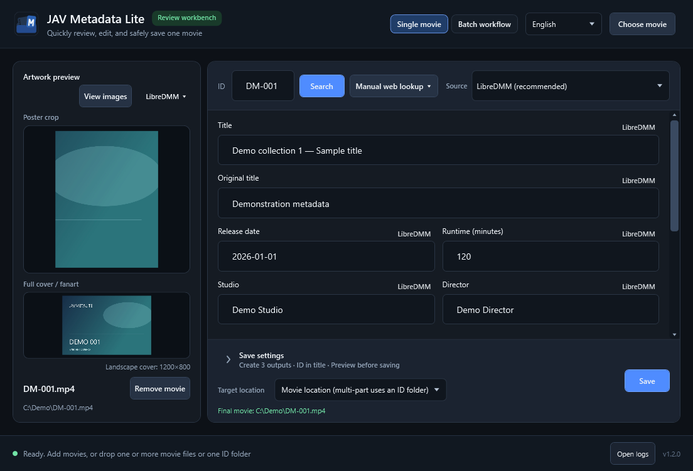

# JavMetaLite


[简体中文](README.zh-Hans.md) · [繁體中文](README.zh-Hant.md) · **English** · [日本語](README.ja.md)

[](https://github.com/Noredge/JavMetaLite/actions/workflows/ci.yml)
[](https://github.com/Noredge/JavMetaLite/actions/workflows/macos.yml)

> Windows **1.2.3** · macOS **1.0.0 (build51)**.

A Windows and macOS app for reviewing and organizing local movie metadata, individually or in batches, with Jellyfin-compatible output.

## Download

| Platform | Requirements | Download |
| --- | --- | --- |
| Windows **1.2.3** | Windows 10/11 x64 | [Portable ZIP](https://github.com/Noredge/JavMetaLite/releases/download/v1.2.3/JavMetaLite-v1.2.3-win-x64-portable.zip) · [Release](https://github.com/Noredge/JavMetaLite/releases/tag/v1.2.3) |
| macOS **1.0.0** | Apple Silicon · macOS 15+ | [App ZIP](https://github.com/Noredge/JavMetaLite/releases/download/macos-v1.0.0/JavMetaLite-macOS-arm64-Release-adhoc.zip) · [Release](https://github.com/Noredge/JavMetaLite/releases/tag/macos-v1.0.0) |

Verify the release SHA-256 before opening. Windows needs WebView2 for the embedded browser. The macOS package is ad-hoc signed and not notarized; see the [first-launch guide](macos/README.md#first-launch). Intel is unverified.



[More screenshots](docs/SCREENSHOTS-v1.2.0.md) · Synthetic demo data.

## Features

- Add movies or scan folders; group CD1/CD2 parts and review movies in a batch queue.
- Search with LibreDMM (recommended default), R18.dev or custom multi-source rules. JAVLibrary is manual web lookup only.
- Edit local NFO metadata, choose artwork sources and stills, and export NFO, poster, fanart and optional stills (`extrafanart`).
- Read `movie.nfo` and folder-level artwork in dedicated movie folders; retain their names when saving in place.
- Compare and delete local images in the viewer; the main window flags low-resolution covers for review.
- Preview file changes before saving; keep movies in place or organize them into a chosen folder. Four UI languages supported.

## Build from source

Install Git and the exact .NET SDK in [global.json](global.json), then clone this repository. Run these commands from its root:

**Windows (PowerShell)**

```powershell
dotnet build .\windows\JavMetaLite.App\JavMetaLite.App.csproj -c Release
.\scripts\New-ReleasePackage.ps1
.\scripts\Test-PortablePackage.ps1
```

**macOS (Xcode or Command Line Tools with macOS 15+ SDK)**

```sh
./scripts/macos/package.sh --arch arm64 --configuration Release --sign-mode adhoc
./scripts/macos/test.sh --arch arm64 --configuration Release
```

Builds restore NuGet packages on first use. Outputs: `release/` (Windows), `artifacts/macos/` (macOS). [Windows](windows/README.md) · [macOS](macos/README.md)

## Repository

| Directory | Purpose |
| --- | --- |
| [windows/](windows/README.md) | Windows application and tests |
| [macos/](macos/README.md) | Native macOS application, Worker and tests |
| [shared/](shared/README.md) | Shared Core, portable imaging and tests |
| [docs/](docs/README.md) | Current guides, technical docs and historical records |
| [scripts/](scripts/README.md) | Build, test and release tools |

[Documentation](docs/README.md) · [Changelog](CHANGELOG.md) · [MIT License](LICENSE) · [Third-party notices](THIRD_PARTY_NOTICES.md)
