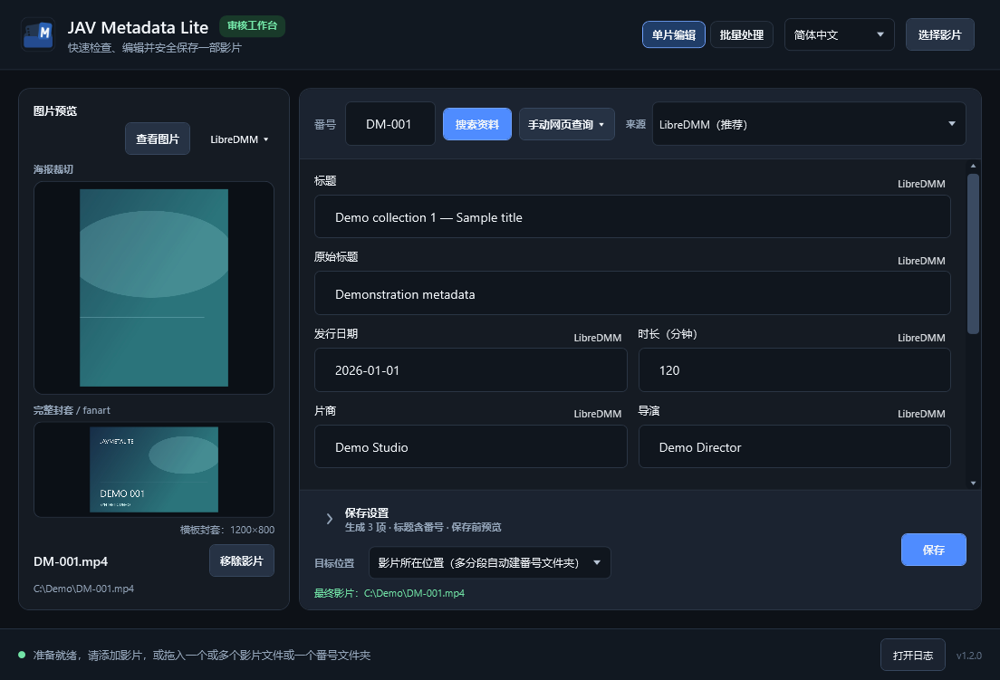

# JavMetaLite


**简体中文** · [繁體中文](README.zh-Hant.md) · [English](README.md) · [日本語](README.ja.md)

[](https://github.com/Noredge/JavMetaLite/actions/workflows/ci.yml)
[](https://github.com/Noredge/JavMetaLite/actions/workflows/macos.yml)

> Windows **1.2.3** · macOS **1.0.0（build50）**。

用于本地影片资料审核与整理的 Windows／macOS 工具，支持单片编辑、批量处理和 Jellyfin 兼容输出。



图片与资料均为合成演示。[更多截图](docs/SCREENSHOTS-v1.2.0.md)。

## 主要功能

- 添加影片或扫描文件夹，将 CD1/CD2 分组为一部影片，在队列中批量审核。
- 支持 LibreDMM（默认推荐）、R18.dev 和自定义多来源；JAVLibrary 仅用于手动网页查询。
- 编辑本地 NFO、选择图片来源与剧照，生成 NFO、海报、fanart 和可选的剧照（`extrafanart`）。
- 支持独立影片目录的 `movie.nfo` 与目录级图片，普通单片原地保存保留其命名。
- 图片查看器支持比较与本地图片删除，主界面提供低分辨率封套提示。
- 保存前预览文件变更，可保持影片原位或整理到指定文件夹；支持简、繁、英、日四语言。

## 快速开始（Windows）

需要 Windows 10/11 x64；无需另装 .NET Runtime，内置浏览器需要 Microsoft Edge WebView2 Runtime。

1. 从 [Releases](https://github.com/Noredge/JavMetaLite/releases) 获取已发布的便携包，或使用提供的本地包，核对 SHA-256 后解压。
2. 运行 `JavMetaLite.exe`，选择或拖入影片／文件夹。
3. 检查番号、搜索资料，按需调整文字、图片与保存设置。
4. 点击保存并检查变更预览。批量保存不要求先打开每部影片的预览。

## 必要提醒

- 批量推荐 LibreDMM；R18 可能因限流而较慢。
- 关闭后不会恢复队列。移除队列项目不删除影片；确认删除本地图片会立即执行。
- 请备份重要媒体。保存遇到失败或取消会停止；恢复失败时请保留恢复目录。
- 来源网站可能含成人内容，请遵守其条款及适用的年龄与法律要求。

## 从源码构建（Windows）

在 Windows 10/11 x64 上安装 Git 和 [global.json](global.json) 指定的准确 .NET SDK 版本（目前为 10.0.400），然后在 PowerShell 中执行：

```powershell
git clone https://github.com/Noredge/JavMetaLite.git
cd JavMetaLite
dotnet build .\JavMetaLite.App\JavMetaLite.App.csproj -c Release
dotnet run --project .\JavMetaLite.App\JavMetaLite.App.csproj -c Release --no-build
```

构建会自动还原 NuGet 依赖，首次构建需要联网。在仓库根目录生成并校验自包含便携包：

```powershell
.\scripts\New-ReleasePackage.ps1
.\scripts\Test-PortablePackage.ps1
```

EXE 所在文件夹、ZIP 和 SHA-256 文件均输出到 `release/`。完整测试命令见[开发与测试](TESTING.md)。

## macOS 1.0

**Apple Silicon · macOS 15+。** 原生编辑器同屏展示海报与完整封套，支持资料、图片编辑和勾选批量查询、保存。默认预览保存变更，保留未编辑的 NFO 内容，写入前检查文件冲突；常用设置自动记忆。

从 [macOS 1.0.0](https://github.com/Noredge/JavMetaLite/releases/tag/macos-v1.0.0) 下载 [App ZIP](https://github.com/Noredge/JavMetaLite/releases/download/macos-v1.0.0/JavMetaLite-macOS-arm64-Release-adhoc.zip)，解压后打开 `JavMetaLite.app`，无需安装 .NET。

macOS 1.0 包使用 ad-hoc 签名，没有 Developer ID 或公证；Apple 未验证发布者，也未公证此包。核对 Release 提供的 ZIP SHA-256，解压后将 `JavMetaLite.app` 移到“应用程序”。如果可信的应用因“无法验证开发者”或“Apple 无法检查”被阻止，先尝试打开，再到 **系统设置 → 隐私与安全性 → 仍要打开**，确认打开此 App。不要用此流程绕过损坏或恶意软件警报。[Apple 说明](https://support.apple.com/zh-cn/102445) · [首次启动](macos/README.md#first-launch)。

自行构建需安装 [global.json](global.json) 指定的 SDK，以及带 macOS 15+ SDK 的 Xcode 或 Command Line Tools。在仓库根目录执行：

```sh
./scripts/macos/package.sh --arch arm64 --configuration Release --sign-mode adhoc
./scripts/macos/test.sh --arch arm64 --configuration Release
```

产物位于 `artifacts/macos/`。CI 包使用 ad-hoc 签名，不公证；Intel 尚未验证。[Mac 指南](macos/README.md) · [验证状态](docs/macos/STATUS.md)。

## 更多

[macOS 版本说明](https://github.com/Noredge/JavMetaLite/releases/tag/macos-v1.0.0) · [Windows 版本说明](docs/RELEASE-NOTES-v1.2.3.md) · [Docs](docs/README.md) · [更新历史](CHANGELOG.md) · [开发与测试](TESTING.md)

Windows 日志和偏好设置位于 `%LOCALAPPDATA%\JavMetaLite`。

[MIT 许可证](LICENSE) · © 2026 Noredge · [第三方声明](THIRD_PARTY_NOTICES.md)。本项目与来源网站无隶属关系，项目许可证不包含网站资料的授权。
