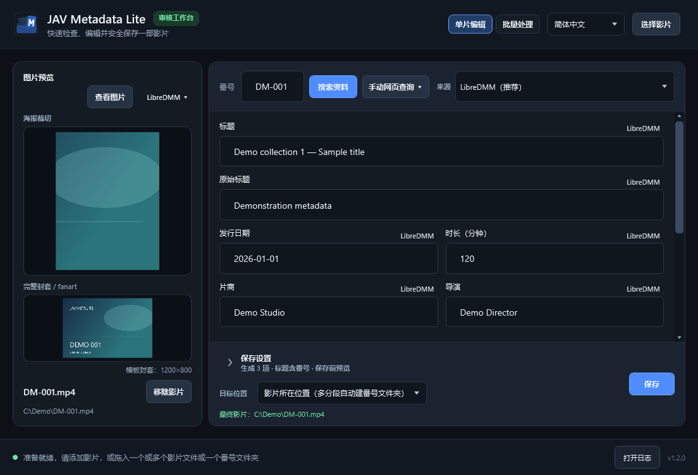

# JavMetaLite


**简体中文** · [繁體中文](README.zh-Hant.md) · [English](README.md) · [日本語](README.ja.md)

[](https://github.com/Noredge/JavMetaLite/actions/workflows/ci.yml)
[](https://github.com/Noredge/JavMetaLite/actions/workflows/macos.yml)

> Windows **1.2.3** · macOS **1.0.0（build51）**。

用于本地影片资料审核与整理的 Windows／macOS 工具，支持单片编辑、批量处理和 Jellyfin 兼容输出。

## 下载

| 平台 | 要求 | 下载 |
| --- | --- | --- |
| Windows **1.2.3** | Windows 10/11 x64 | [便携 ZIP](https://github.com/Noredge/JavMetaLite/releases/download/v1.2.3/JavMetaLite-v1.2.3-win-x64-portable.zip) · [Release](https://github.com/Noredge/JavMetaLite/releases/tag/v1.2.3) |
| macOS **1.0.0** | Apple Silicon · macOS 15+ | [App ZIP](https://github.com/Noredge/JavMetaLite/releases/download/macos-v1.0.0/JavMetaLite-macOS-arm64-Release-adhoc.zip) · [Release](https://github.com/Noredge/JavMetaLite/releases/tag/macos-v1.0.0) |

打开前请核对 Release 的 SHA-256。Windows 内置浏览器需要 WebView2；macOS 包使用 ad-hoc 签名、未公证，详见[首次启动指南](macos/README.md#first-launch)。Intel 尚未验证。



[更多截图](docs/SCREENSHOTS-v1.2.0.md) · 图片与资料均为合成演示。

## 主要功能

- 添加影片或扫描文件夹，将 CD1/CD2 分组为一部影片，在队列中批量审核。
- 支持 LibreDMM（默认推荐）、R18.dev 和自定义多来源；JAVLibrary 仅用于手动网页查询。
- 编辑本地 NFO、选择图片来源与剧照，生成 NFO、海报、fanart 和可选的剧照（`extrafanart`）。
- 支持独立影片目录的 `movie.nfo` 与目录级图片，普通单片原地保存保留其命名。
- 图片查看器支持比较与本地图片删除，主界面提供低分辨率封套提示。
- 保存前预览文件变更，可保持影片原位或整理到指定文件夹；支持简、繁、英、日四语言。

## 从源码构建

安装 Git 和 [global.json](global.json) 指定的准确 .NET SDK，克隆仓库后在根目录执行：

**Windows（PowerShell）**

```powershell
dotnet build .\windows\JavMetaLite.App\JavMetaLite.App.csproj -c Release
.\scripts\New-ReleasePackage.ps1
.\scripts\Test-PortablePackage.ps1
```

**macOS（需带 macOS 15+ SDK 的 Xcode 或 Command Line Tools）**

```sh
./scripts/macos/package.sh --arch arm64 --configuration Release --sign-mode adhoc
./scripts/macos/test.sh --arch arm64 --configuration Release
```

首次构建会还原 NuGet 依赖。产物目录：Windows 为 `release/`，macOS 为 `artifacts/macos/`。 [Windows](windows/README.md) · [macOS](macos/README.md)

## 仓库导航

| 目录 | 用途 |
| --- | --- |
| [windows/](windows/README.md) | Windows 应用与测试 |
| [macos/](macos/README.md) | macOS 原生应用、Worker 与测试 |
| [shared/](shared/README.md) | 共享 Core、可移植图像处理与测试 |
| [docs/](docs/README.md) | 使用指南、长期技术文档与历史记录 |
| [scripts/](scripts/README.md) | 构建、测试与发布工具 |

[文档](docs/README.md) · [Changelog](CHANGELOG.md) · [MIT License](LICENSE) · [Third-party notices](THIRD_PARTY_NOTICES.md)
