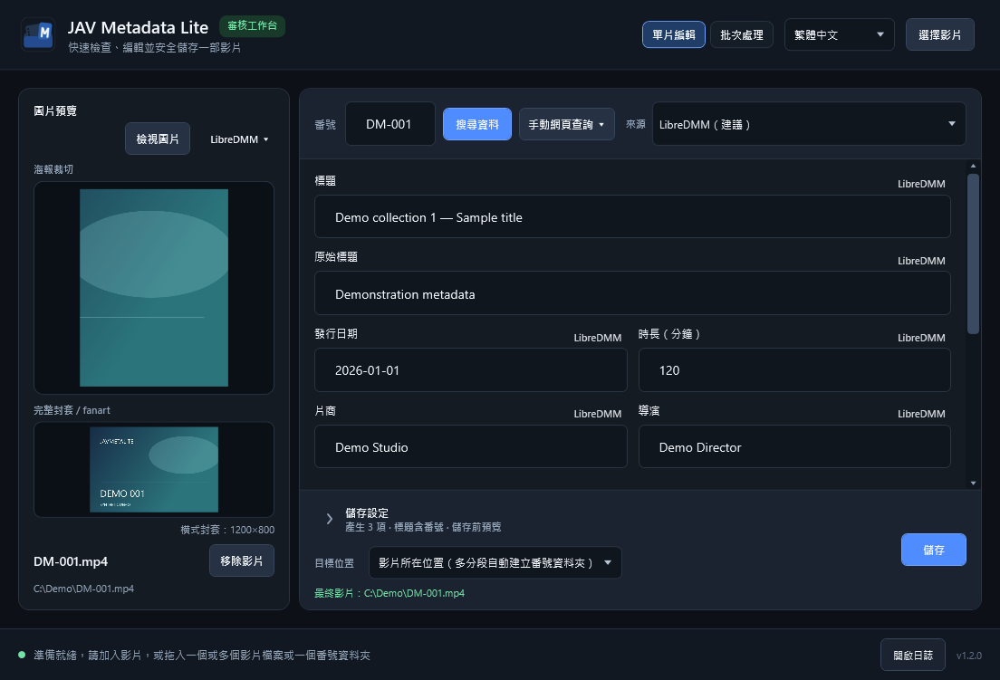

# JavMetaLite


[简体中文](README.zh-Hans.md) · **繁體中文** · [English](README.md) · [日本語](README.ja.md)

[](https://github.com/Noredge/JavMetaLite/actions/workflows/ci.yml)
[](https://github.com/Noredge/JavMetaLite/actions/workflows/macos.yml)

> Windows **1.2.3** · macOS **1.0.0（build51）**。

用於本機影片資料審核與整理的 Windows／macOS 工具，支援單片編輯、批次處理及 Jellyfin 相容輸出。

## 下載

| 平台 | 需求 | 下載 |
| --- | --- | --- |
| Windows **1.2.3** | Windows 10/11 x64 | [可攜 ZIP](https://github.com/Noredge/JavMetaLite/releases/download/v1.2.3/JavMetaLite-v1.2.3-win-x64-portable.zip) · [Release](https://github.com/Noredge/JavMetaLite/releases/tag/v1.2.3) |
| macOS **1.0.0** | Apple Silicon · macOS 15+ | [App ZIP](https://github.com/Noredge/JavMetaLite/releases/download/macos-v1.0.0/JavMetaLite-macOS-arm64-Release-adhoc.zip) · [Release](https://github.com/Noredge/JavMetaLite/releases/tag/macos-v1.0.0) |

開啟前請核對 Release 的 SHA-256。Windows 內建瀏覽器需要 WebView2；macOS 套件採用 ad-hoc 簽署、未公證，詳見[首次啟動指南](macos/README.md#first-launch)。Intel 尚未驗證。



[更多擷圖](docs/SCREENSHOTS-v1.2.0.md) · 圖片與資料均為合成示範。

## 主要功能

- 加入影片或掃描資料夾，將 CD1/CD2 分組為一部影片，在佇列中批次審核。
- 支援 LibreDMM（預設建議）、R18.dev 與自訂多來源；JAVLibrary 僅供手動網頁查詢。
- 編輯本機 NFO、選擇圖片來源與劇照，產生 NFO、海報、fanart 與選用的劇照（`extrafanart`）。
- 支援獨立影片資料夾的 `movie.nfo` 與資料夾層級圖片，普通單片原地儲存保留其命名。
- 圖片檢視器支援比較與本機圖片刪除，主介面提供低解析度封套提示。
- 儲存前預覽檔案變更，可保持影片原位或整理到指定資料夾；支援簡、繁、英、日四語言。

## 從原始碼建置

安裝 Git 和 [global.json](global.json) 指定的確切 .NET SDK，複製儲存庫後在根目錄執行：

**Windows（PowerShell）**

```powershell
dotnet build .\windows\JavMetaLite.App\JavMetaLite.App.csproj -c Release
.\scripts\New-ReleasePackage.ps1
.\scripts\Test-PortablePackage.ps1
```

**macOS（需含 macOS 15+ SDK 的 Xcode 或 Command Line Tools）**

```sh
./scripts/macos/package.sh --arch arm64 --configuration Release --sign-mode adhoc
./scripts/macos/test.sh --arch arm64 --configuration Release
```

首次建置會還原 NuGet 相依套件。輸出目錄：Windows 為 `release/`，macOS 為 `artifacts/macos/`。 [Windows](windows/README.md) · [macOS](macos/README.md)

## 儲存庫導覽

| 目錄 | 用途 |
| --- | --- |
| [windows/](windows/README.md) | Windows 應用程式與測試 |
| [macos/](macos/README.md) | macOS 原生應用程式、Worker 與測試 |
| [shared/](shared/README.md) | 共用 Core、可攜式影像處理與測試 |
| [docs/](docs/README.md) | 使用指南、長期技術文件與歷史記錄 |
| [scripts/](scripts/README.md) | 建置、測試與發佈工具 |

[文件](docs/README.md) · [Changelog](CHANGELOG.md) · [MIT License](LICENSE) · [Third-party notices](THIRD_PARTY_NOTICES.md)
