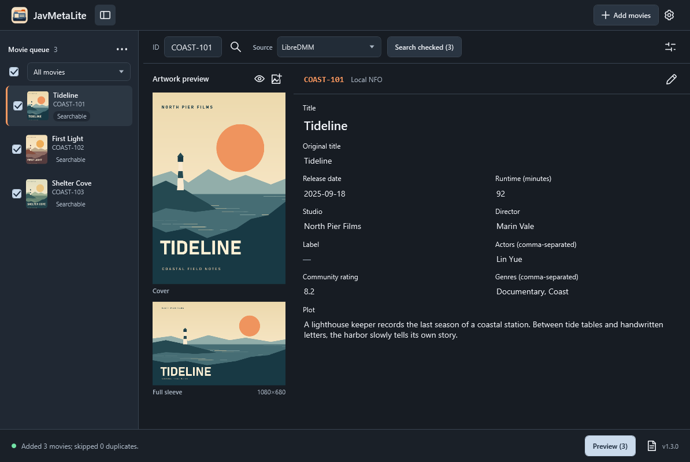
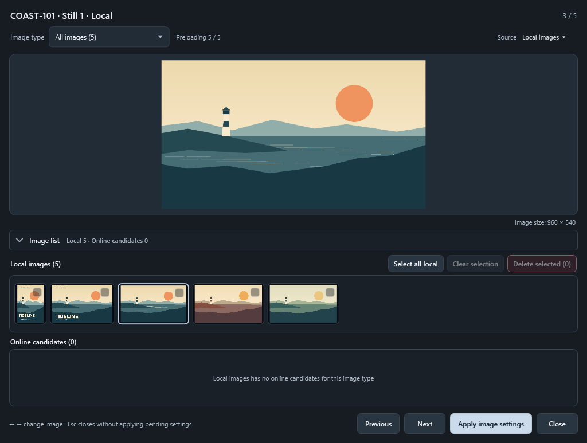

# Screenshots

Both platforms use fictional movie metadata and artwork in these screenshots.

## Windows 1.3.0

The queue shows the checked movies. Select a row to review its poster, full cover and metadata.

View the workspace in [简体中文](images/windows-1.3.0-workspace.zh-Hans.png), [繁體中文](images/windows-1.3.0-workspace.zh-Hant.png) or [日本語](images/windows-1.3.0-workspace.ja.png).

Open the artwork viewer to choose which stills to save with the movie.

[简体中文剧照查看器](images/windows-1.3.0-artwork.zh-Hans.png)

## macOS 1.1.0

The workbench shows local artwork and editable movie details alongside the save settings.

Open **Choose images** to review posters, fanart and individual stills for the current movie.

Workbench in [简体中文](images/macos-1.1.0-workspace.zh-Hans.png), [繁體中文](images/macos-1.1.0-workspace.zh-Hant.png) and [日本語](images/macos-1.1.0-workspace.ja.png). [简体中文选图窗口](images/macos-1.1.0-stills.zh-Hans.png)
