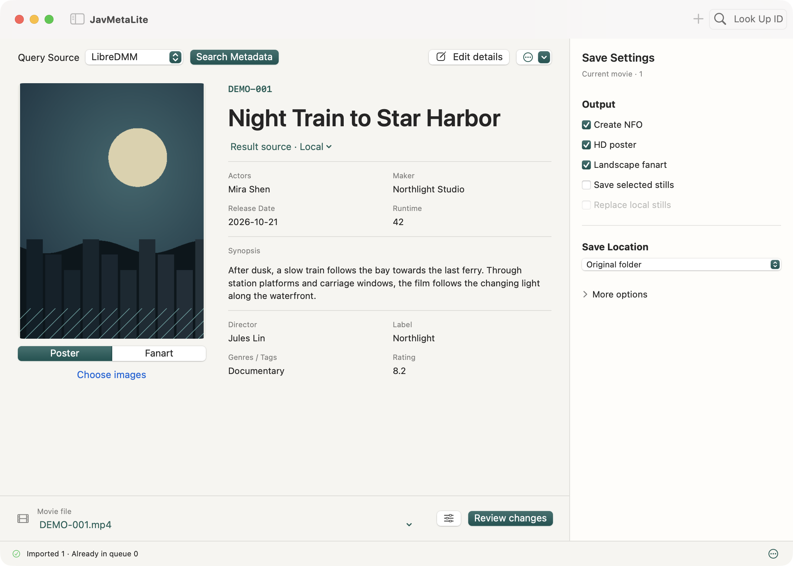
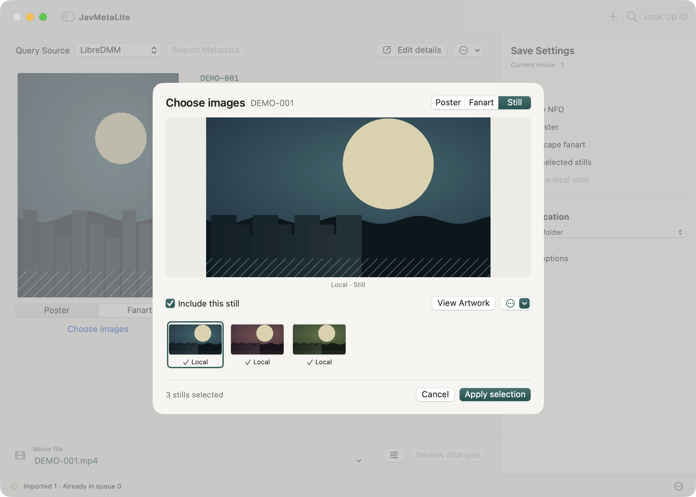
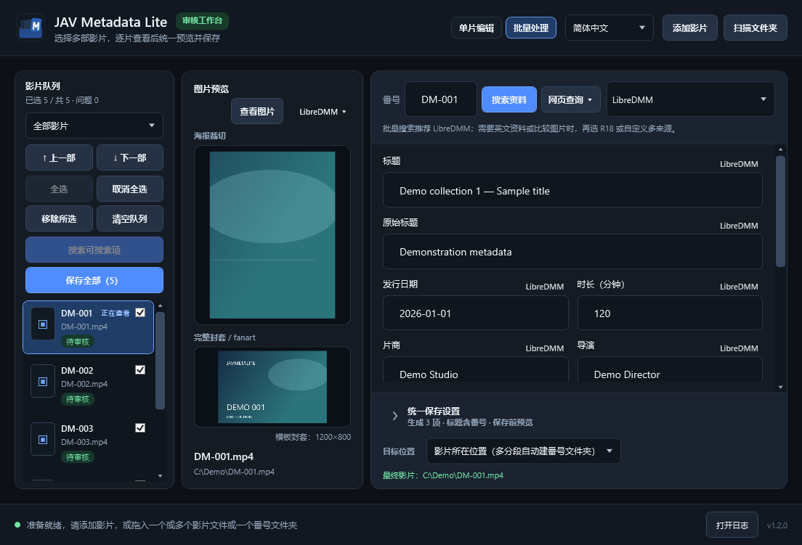
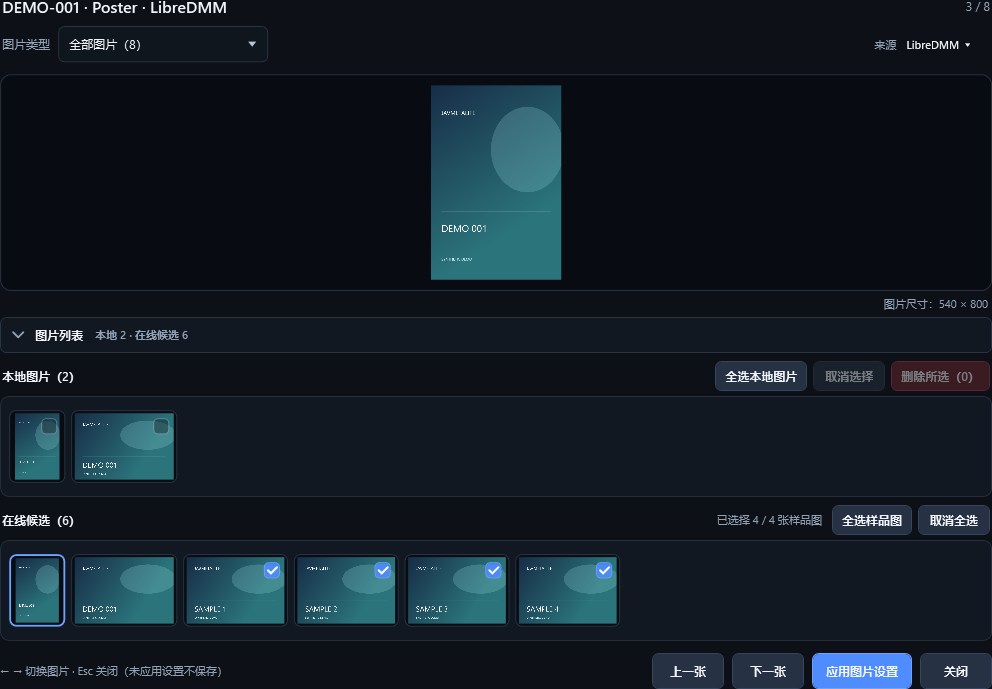

# Screenshots

Both platforms use fictional movie metadata and artwork in these screenshots.

## macOS 1.1.0

The workbench shows local artwork and editable movie details alongside the save settings.

Open **Choose images** to review posters, fanart and individual stills for the current movie.

Workbench in [简体中文](images/macos-1.1.0-workspace.zh-Hans.png), [繁體中文](images/macos-1.1.0-workspace.zh-Hant.png) and [日本語](images/macos-1.1.0-workspace.ja.png). [简体中文选图窗口](images/macos-1.1.0-stills.zh-Hans.png)

## Windows 1.2.0

### Batch workspace

### Artwork viewer

### Other languages

Main workspace: [English](images/javmetalite-v1.2.0-main-single.en.png), [简体中文](images/javmetalite-v1.2.0-main-single.zh-Hans.png), [繁體中文](images/javmetalite-v1.2.0-main-single.zh-Hant.png), [日本語](images/javmetalite-v1.2.0-main-single.ja.png).
