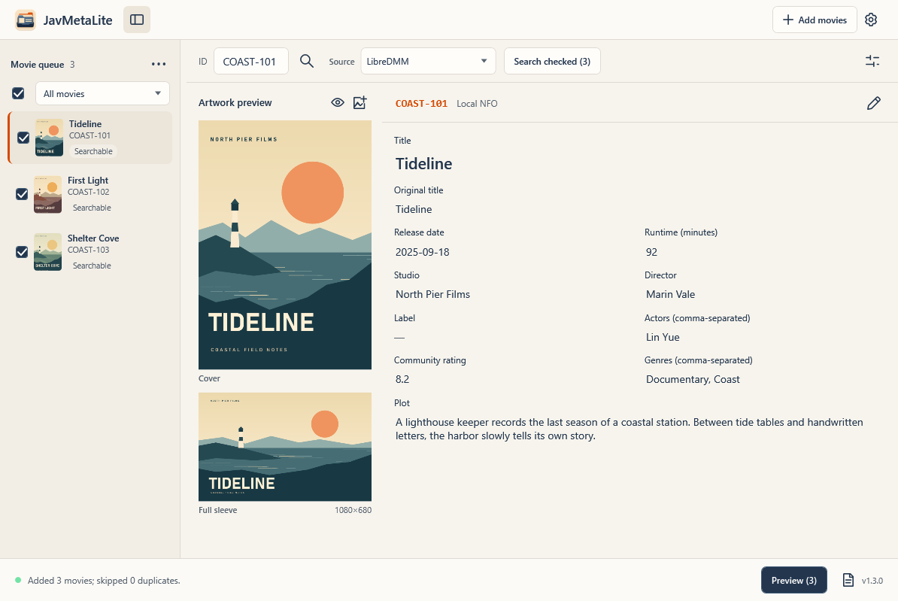

# Windows

Windows 10/11 x64 · WPF · .NET SDK pinned in [global.json](../global.json).

## Quick start (Windows)

Windows 10/11 x64. No separate .NET Runtime installation; the embedded browser requires Microsoft Edge WebView2 Runtime.

1. Download the [Windows 1.3.0 portable ZIP](https://github.com/Noredge/JavMetaLite/releases/download/v1.3.0/JavMetaLite-v1.3.0-win-x64-portable.zip) and extract it.
2. Open `JavMetaLite.exe`. Use **Add movies** or drag in files and folders together. When the import review opens, choose the recognized items or adjust the selection.
3. Check the catalog numbers and choose a source. Use the magnifying glass for the current number or search the checked movies again after changing sources.
4. Review the poster, full cover and metadata in the main window. Use the pencil to edit. Open save settings to choose the outputs and destination, then preview and save.

<br>
<sub>Windows 1.3.0</sub>

## Keep in mind

- LibreDMM is recommended for batches. R18 rate limits can slow searches.
- The queue is not restored after closing. Removing queue entries does not delete movie files; confirmed local-image deletion is immediate.
- Back up important media. Saves stop on failure or cancellation; keep recovery folders if restoration fails.
- Sources may contain adult material. Respect their terms and applicable age/legal requirements.


## Build and run

From the repository root, in PowerShell:

```powershell
dotnet build .\windows\JavMetaLite.App\JavMetaLite.App.csproj -c Release
dotnet run --project .\windows\JavMetaLite.App\JavMetaLite.App.csproj -c Release --no-build
.\scripts\Test-Automated.ps1
.\scripts\New-ReleasePackage.ps1
.\scripts\Test-PortablePackage.ps1
```

The first build restores NuGet packages and needs network access. Find the portable EXE and ZIP in `release/`. Logs and preferences are under `%LOCALAPPDATA%\JavMetaLite`.

## Projects

| Directory | Purpose |
| --- | --- |
| `JavMetaLite.App/` | WPF application, UI resources and WebView2 integration |
| `JavMetaLite.Imaging.Windows/` | Windows image processing |
| `JavMetaLite.SmokeTests/` | Core behavior smoke tests |
| `JavMetaLite.RegressionTests/` | File transactions and save regressions |
| `JavMetaLite.UiSmokeTests/` | WPF behavior, layout and performance checks |

[Shared components](../shared/README.md) · [Testing](../docs/windows/TESTING.md) · [Maintenance](../docs/maintainer/MAINTENANCE.zh-Hans.md) · [Scripts](../scripts/README.md)
